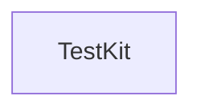

# Custom PowerShell Modules

A personal collection of independently versioned PowerShell modules,
published to the PowerShell Gallery for reuse
in scripts and GitHub Actions workflows across my repositories.
Each module is versioned, released and published on its own:
a GitHub Release on the tag `<ModuleName>/vX.Y.Z` publishes that module,
built into a single file, to GitHub Packages and then to the Gallery.

| Module                                                            | Description                                                                                                            | Version |
| :---------------------------------------------------------------- | :--------------------------------------------------------------------------------------------------------------------- | :------ |
| [TestKit](src/TaffarelJr.TestKit)                                 | A minimal, homegrown test-writing kit - assertions, tallies, and output capture.                                       | -       |

## Dependencies

An arrow runs from a module to each module it requires: `Git --> ProcessInvocation`
means `Git` lists `ProcessInvocation` in its manifest's `RequiredModules`,
so installing `Git` installs it too.
The diagram is generated from the manifests by `build/Get-DependencyDiagram.ps1`,
and a test fails when it differs from them,
so a pull request that adds a module also adds its node.

<!-- dependency-diagram -->

<!-- /dependency-diagram -->
